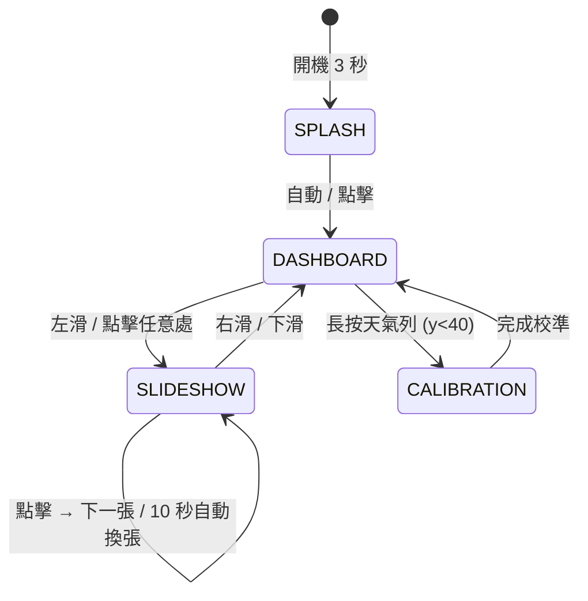

# ESP32 公車到站看板

以 HW-950 開發板（ESP32-D0WD-V3，2.4" ILI9341 TFT）顯示台北市南港路三段新新公園站的公車到站時間，外加即時溫度、空氣品質（AQI）與標準局時鐘及照片slideshow，當做出門前的快速看板。

## 專案簡介

| 項目 | 內容 |
| --- | --- |
| 目標 | 開機顯示 IP 位址；顯示新新公園站公車即時到站（TDX API）與天氣、AQI |
| 開發板 | HW-950，型號 ESP32-2432S024R（[sconline.com.tw](https://www.sconline.com.tw/tw/product/show.php?num=34727&page=1&kind1=&kw=TFT)） |
| 核心晶片 | ESP32-D0WD-V3 (rev v3.1), 240 MHz, 4 MB Flash, 320 KB SRAM |
| 顯示器 | 2.4" TFT，ILI9341，240×320，4-wire SPI（官方 spec 確認） |
| 觸控 | XPT2046 電阻式（CS=33），與 TFT 共用 HSPI，`-D USE_HSPI_PORT=1` |
| 通訊 | Wi-Fi 2.4GHz, 藍牙 4.2, USB-C (CH340 燒錄) |

## 畫面架構與互動

目前實作兩個分頁，觸控切換：



| 頁面 | 內容 | 更新規則 |
| --- | --- | --- |
| DASHBOARD | 天氣列 40px（溫度、AQI、時鐘）＋公車列表（西向 4 筆、東向 4 筆） | 公車 60s 輪詢 TDX、天氣 10min、8s 自動翻頁（各向獨立） |
| SLIDESHOW | 全螢幕 320×240 照片（SD 卡 `/photos`） | 10s 自動換張；點螢幕手動換下一張 |
| CALIBRATION | 觸控四角點校準（XPT2046） | 長按天氣列進入，完成後回 DASHBOARD |

## 文件導覽

各檔各管一攤事實，不重覆。改文件前先看「不寫什麼」那欄：

| 文件 | 唯一職責 | 不寫什麼 |
| --- | --- | --- |
| 本檔 `README.md` | 專案總覽、進度、文件地圖 | 不寫腳位細節、不寫 API 端點 |
| `docs/ESP32.md` | 硬體唯一事實來源（晶片、腳位、init 前置） | 不寫韌體邏輯 |
| `docs/ARCHITECTURE.md` | 模組分工、資料流、記憶體預算 | 硬體腳位轉引 ESP32.md |
| `docs/TDX.md` | TDX 交通 API 端點、OAuth、金鑰 | 韌體實作轉引 ARCHITECTURE |
| `docs/API_INTEGRATIONS.md` | 外部 API 整合紀錄：TDX 交通 + open-meteo 天氣/AQI，踩過的坑 | 端點細節轉引 TDX.md |
| `DEVELOPMENT.md` | 建置/燒錄/監控指令、FAQ | 不寫架構 |
| `CLAUDE.md` | AI 協作者規則 + 腳位速查 | 詳盡規格轉引 ESP32.md |

## 硬體規格

腳位已依官方 spec（bitbyg.dk）確認並實測，完整腳位表見 [docs/ESP32.md](docs/ESP32.md)。速查：

| 訊號 | GPIO |
| --- | --- |
| TFT_SCLK / MOSI / MISO | 14 / 13 / 12 |
| TFT_CS / TFT_DC | 15 / 2 |
| TFT_BL（背光） | 27（HIGH 點亮） |
| 觸控 CS（XPT2046） | 33 |
| SD/TF CS | 5 |
| RGB LED (G/B/R) | 17 / 4 / 16 |

注意：TFT init 前必須把觸控 CS=33 與 SD CS=5 拉高隔離，否則 MISO 匯流排被扯低會全白。

## 函式庫

| 函式庫 | 用途 | 版本 |
| --- | --- | --- |
| Bodmer/TFT_eSPI | ILI9341 螢幕驅動 + 觸控 | ^2.5.43 |
| bblanchon/ArduinoJson | TDX API JSON 解析 | ^6.21.2 |
| bodmer/TJpg_Decoder | JPEG 串流解碼 (Slideshow) | ^1.0.0 |

腳位由 `platformio.ini` build_flags 注入（`USER_SETUP_LOADED=1`、`ILI9341_DRIVER=1`、`TFT_BL=27`、`USE_HSPI_PORT=1`），不需要改 TFT_eSPI 庫檔案，也不建 `User_Setup.h`。

## 快速開始

```bash
# 1. 開啟專案（VS Code + PlatformIO 擴充）
code /Users/wolfgang/Projects/ESP32_Bus_ETA

# 2. 本機參數（Wi-Fi、TDX 金鑰）填在 include/config_local.h（已 gitignored，勿上傳）

# 3. 燒錄與監控
pio run -e esp32dev -t upload
pio device monitor
```

上傳後要真正執行，得按板子實體 RST 鈕。

## 目前進度 (v1.2.0 - 2026-10-24)

```text
██████████ 100%  螢幕跑通（ILI9341 + TFT_eSPI + init 隔離觸控/SD CS）
██████████ 100%  Wi-Fi 連線（No7）
██████████ 100%  TDX 拉數 + 上屏（新新公園東西向，已顯示車次）
██████████ 100%  open-meteo 天氣 + AQI（天氣列 40px，10min 週期）
██████████ 100%  觸控整合（TFT_eSPI 內建 XPT2046，校準完成）
██████████ 100%  UI 定版（Splash/NTP、4筆/頁、8秒自動翻頁、夜間暫停、全螢幕 Slideshow）
██████████ 100%  Slideshow RGB565 byte-order 修正、首張不重複繪製
██████████ 100%  多縣市 TDX 支援（TARGET_CITY 設定、動態端點）
```

里程碑：

- 2026-10-04 專案初始化（PlatformIO + 模組骨架）
- 2026-10-17 螢幕正式跑通；改用官方 TFT_eSPI + ILI9341，確認背光 27、init 需隔離觸控/SD CS，TDX 東西向到站資料上屏成功。
- 2026-10-18 整合 open-meteo 天氣與 AQI（免金鑰），TDX.md 移入 docs/
- 2026-10-23 **v1.0.0 發布**：觸控修復、Splash 顯示 NTP 時間、公車分頁 4筆/8秒/東西向獨立、夜間 01–05 暫停 TDX、Slideshow 全螢幕串流解碼
- 2026-10-24 **v1.2.0 發布**：Slideshow 色彩修正（setSwapBytes）、雙重繪製修正（drawSlideshow 不設 photoDirty）、TDX 多縣市支援（TARGET_CITY）、授權條款 (LICENSE.md)

## TDX 多縣市切換說明

TDX API 依縣市分端點。目前實作以 `TARGET_CITY`（`config.h`）動態組端點，預設 `"Taipei"`，站點為 `TARGET_STOP_NAME = "新新公園"`（南港路三段）。若要改其他縣市：

1. **修改 `config.h` 或 `config_local.h`**：

   ```cpp
   #define TARGET_CITY       "Taipei"   // 改為 "Taichung"、"Kaohsiung"、"NewTaipei" 等
   #define TARGET_STOP_NAME  "新新公園"  // 改為該縣市的站名（需對應 TDX 站名資料）
   ```

2. **站名查詢**：TDX 站名需符合官方資料格式。可先用 [TDX API 文件](https://tdx.transportdata.tw/) 的「公車站牌資料」端點查詢該縣市站名清單。

3. **方向判斷邏輯**（`BusData.cpp` 的 `parseTDXResponse()`）：
   - 目前依 `Direction` 欄位（0=去程/1=返程）+ 站序排序判斷東西向
   - 不同縣市路線規劃不同，可能需微調「哪一個 direction 對應東/西向」的對應表

4. **端點已動態化**：`TDXClient.cpp` 的 `fetchBusETAByName()` 使用 `TARGET_CITY` 組合 URL，改 config 即生效，不需改程式碼。

## 授權條款

本專案採用 **MIT License 條款開放原始碼**，但增加以下限制：

- **不得作為商品銷售**（包含但不限於：成品販售、整合進商業產品販售、授權他人販售獲利）。
- **例外授權**：下列主體不受上述「不得商品銷售」限制，得自由商業化使用、修改、散佈、授權或販售本專案衍生產品：
  - 沈伯洋
  - 沈伯洋台北市長競選組織
  - 黑熊學院

以上例外主體亦享有完整的 MIT License 權利（使用、複製、修改、合併、發布、散佈、再授權、銷售副本）。
